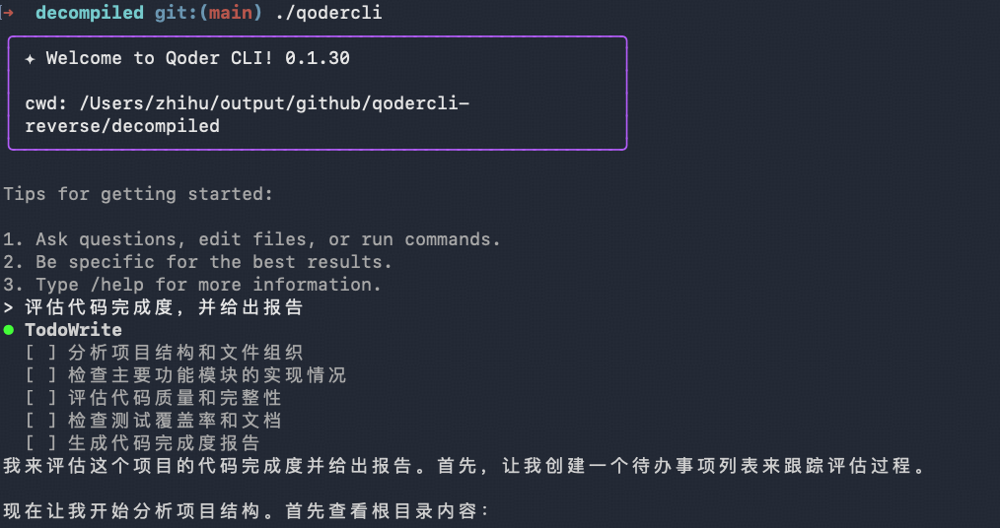
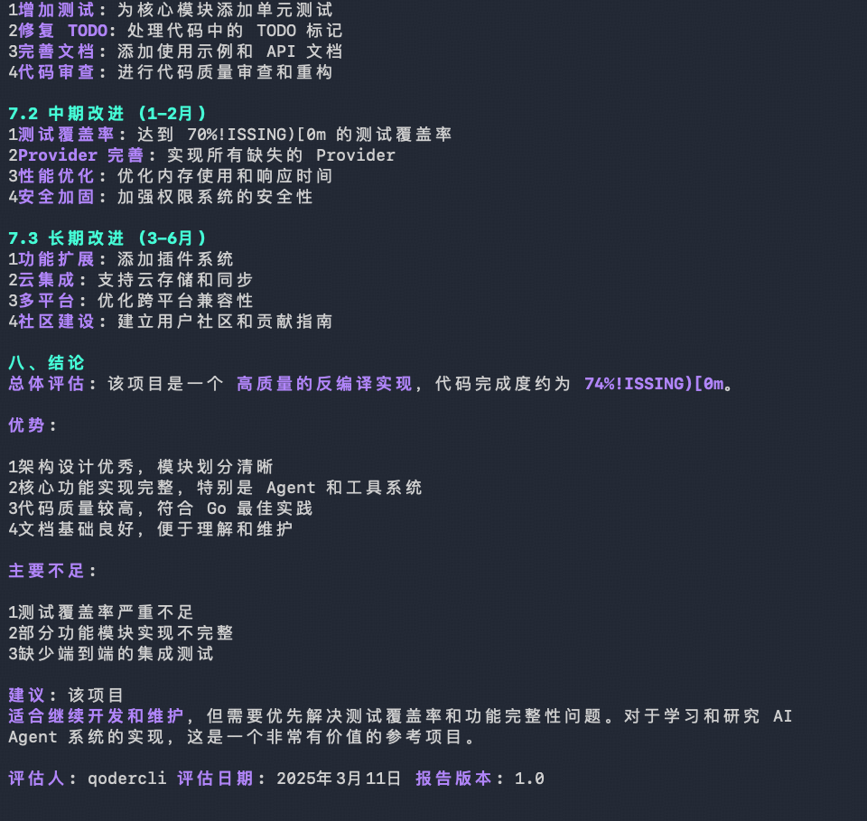

# qodercli-reverse Reverse Engineering Project

> **Note**: qodercli-reverse is an internal closed-source project by Alibaba. This project reconstructs its architecture through reverse engineering. The decompiled result compiles and runs; it is provided for learning and research only.

## Project Goals

- **Analysis target**: qodercli-reverse v0.1.29 (Mach-O arm64 Go binary, ~37MB)
- **Analysis method**: symbol table analysis, string extraction, behavior observation, configuration analysis
- **Deliverables**: complete architecture documentation + decompiled code examples
- **Decompilation result**: core architecture successfully reconstructed; decompiled code compiles and runs

## Project Status Overview

The core architecture reverse engineering is complete. Implementation status of the main functional modules:

### Fully Implemented
- **Core architecture analysis**: complete architecture documentation generated
- **Agent core system**: message loop, tool calls, permission control
- **TUI interactive interface**: Bubble Tea framework + Markdown rendering
- **Base tool set**: Read/Write/Edit/Grep/Bash/Glob/Delete and 9 other tools
- **Permission security system**: fine-grained rule engine, Hook interception mechanism

### Partially Implemented (core features available)
- **Multi-Provider support**: Qoder + OpenAI available, extensible to other Providers
- **MCP protocol integration**: Client library implemented, supports stdio/SSE transport
- **CLI command framework**: basic CLI functionality available, supports interactive mode
- **Configuration management system**: basic configuration structure, supports model selection and basic settings
- **Runtime mode support**: interactive mode complete, other modes pending

### Pending Implementation
- **Session management**: session persistence and recovery
- **Advanced tool extensions**: WebFetch/WebSearch/Task/TodoWrite/Skill, etc.
- **MCP management features**: CLI subcommands, server management, OAuth authentication
- **Jobs concurrency system**: worktree task management
- **SubAgent system**: sub-agent scheduling and execution
- **GitHub integration**: PR creation, code review, Actions integration

**Detailed gap analysis**: see [Decompiled Gap Analysis](docs/11-decompiled-gap-analysis.md)

**Completion date**: 2026-03-09

## Results Showcase

The following screenshots show the actual running interface of qodercli-reverse, demonstrating the completed reverse engineering project:

### Screenshot 1: qodercli-reverse Interactive Interface (1014x536)


### Screenshot 2: qodercli-reverse Tool Usage Interface (960x909)


## Documentation Directory

```
docs/
├── architecture-overview.md      # Complete architecture overview
├── official-architecture.md      # Official qodercli-reverse architecture analysis (refactoring reference)
├── 01-package-structure.md       # Package structure and dependencies
├── 02-cli-commands.md            # CLI command system
├── 03-llm-integration.md         # LLM integration
├── 04-mcp-protocol.md            # MCP protocol
├── 05-tools-system.md            # Tool system
├── 06-session-management.md      # Session management
├── 07-permission-security.md     # Permission security
├── 08-config-api.md              # Configuration and API
├── 09-github-integration.md      # GitHub integration
├── 10-subagent-skill.md          # SubAgent and Skill
├── 11-decompiled-gap-analysis.md # Decompiled gap analysis
└── 12-bubbletea-analysis.md      # Bubble Tea usage analysis
```

## decompiled Directory Architecture

```
decompiled/
├── cmd/                          # CLI command entry
│   └── root.go
├── core/                         # Core logic
│   ├── agent/                    # Agent system
│   │   ├── agent/agent.go        # Main loop
│   │   ├── provider/             # LLM Provider
│   │   ├── tools/                # Tool implementations
│   │   ├── permission/           # Permission control
│   │   └── state/                # State management
│   ├── config/                   # Configuration loading
│   ├── resource/mcp/             # MCP client
│   ├── pubsub/                   # Event system
│   └── types/                    # Type definitions
├── tui/                          # TUI interface
│   ├── app/                      # Application startup
│   └── components/               # UI components
├── main.go                       # Program entry
└── go.mod/go.sum                 # Dependency management
```

**Code statistics**: about 15 files, ~3350 lines of code

## Core Architecture

```
┌─────────────────┐
│   CLI / TUI     │
└────────┬────────┘
         │
┌────────▼────────┐
│   Agent Core    │  ← Main loop, Provider, Tools, Permission
└────────┬────────┘
         │
┌────────▼────────┐
│   Resources     │  ← MCP, Skill, SubAgent
└────────┬────────┘
         │
┌────────▼────────┐
│   Utilities     │  ← HTTP, Token, Storage, API
└────────┬────────┘
```

## Development Workflow

Before modifying or extending code, follow the reverse engineering workflow below to keep the implementation consistent with the official architecture:

### 1. Locate the Official Binary

```bash
# Find the official qodercli-reverse binary location
which qodercli-reverse
# Example output: /Users/zhihu/.qoder/bin/qodercli-reverse/qodercli-reverse-0.1.29
```

### 2. Reverse Engineer the Target Module

Use decompilation tools to analyze the functions, methods, and call relationships of the official implementation:

```bash
# Extract the symbol table and search for relevant packages and functions
nm -gU /path/to/qodercli-reverse | grep "package or function keyword"

# Extract strings to locate functional modules
strings /path/to/qodercli-reverse | grep "keyword"

# Disassemble a specific function with Go tools
go tool objdump -s "function name" /path/to/qodercli-reverse

# Example: analyze MCP-related implementation
nm -gU $(which qodercli-reverse) | grep mcp
strings $(which qodercli-reverse) | grep -i "mcp"
```

### 3. Compare with the Official Architecture

Refer to the official package structure in `docs/official-architecture.md`:

```
code.alibaba-inc.com/qoder-core/qodercli-reverse/
├── cmd/                    # Command-line interface layer
├── core/                   # Core business logic
│   ├── agent/             # Agent implementation
│   ├── auth/              # Authentication
│   ├── config/            # Configuration management
│   └── resource/mcp/      # MCP integration
└── tui/                    # Terminal UI
```

Ensure your changes match the official layered architecture and responsibility boundaries.

### 4. Plan the Implementation

Before coding:

1. **Read the relevant docs**: check the corresponding module analysis in `docs/`
2. **Review the gap analysis**: refer to `docs/11-decompiled-gap-analysis.md` for missing features
3. **Make a plan**: decide which files to create or modify and how to organize the code
4. **Validate the design**: ensure the plan aligns with the official architecture

### 5. Implement and Verify

- Organize code following the official package structure
- Use the official naming conventions (e.g., tool parameter types: `{Tool}Params`)
- After implementation, compare behavior with the official binary

## Usage

1. **View the architecture**: start with `docs/architecture-overview.md`
2. **Official architecture reference**: see `docs/official-architecture.md` for the official code structure (used as refactoring reference)
3. **Explore modules**: read the corresponding module docs (01-11)
4. **Reference code**: inspect the decompiled examples in `decompiled/`

## Implementation Plan (Based on Gap Analysis)

Based on [Decompiled Gap Analysis](docs/11-decompiled-gap-analysis.md), the following implementation priorities are recommended:

### Phase 1: Core Usability (P0 - Highest Priority)

1. **Introduce the Cobra CLI framework**
   - Build the complete `cmd/` directory structure
   - Bind all flags and subcommands
   - Resolve the currently hardcoded CLI logic

2. **Complete the configuration system**
   - Support multi-layer configuration loading (environment variables, global config, project config)
   - Implement the complete Config struct
   - Add Claude configuration compatibility

3. **Implement session management**
   - Session persistence storage
   - Support `-c` (continue) and `-r` (resume)
   - Session recovery mechanism

4. **Build the System Prompt Builder**
   - Dynamically generate system prompts
   - Integrate tool descriptions, environment info, permission rules

### Phase 2: Feature Completion (P1 - Medium Priority)

5. **Complete missing tools**
   - WebFetch, WebSearch, Task, TodoWrite, AskUserQuestion
   - Dynamically register MCP tools with the Agent

6. **Implement the MCP subcommand system**
   - `mcp add/get/list/remove/auth` subcommands
   - MCP server configuration management
   - OAuth authentication flow

7. **Implement non-interactive Print mode**
   - `-p` parameter support
   - Multiple output formats (text/json/stream-json)
   - Streaming output handling

### Phase 3: Advanced Features (P2 - Lower Priority)

8. **Worktree/Jobs system**
   - Git worktree concurrent task management
   - `jobs` and `rm` subcommands
   - Kubernetes integration support

9. **SubAgent and Skill system**
   - Sub-agent scheduling and execution
   - Skill invocation and management
   - Built-in SubAgent type implementations

10. **GitHub integration**
    - PR creation and code review
    - GitHub Actions integration
    - Code search and repository management

11. **Other missing features**
    - Auto-update (`update` subcommand)
    - Feedback system (`feedback` subcommand)
    - Status check (`status` subcommand)
    - Shell auto-completion

**Detailed implementation guide**: see [Official Architecture](docs/official-architecture.md) and the concrete suggestions in [Gap Analysis](docs/11-decompiled-gap-analysis.md).

## Notes

- Decompiled code is derived from the binary and may differ from the original implementation
- Code is untested; not recommended for direct production use
- For learning and architecture reference only

## Common Reverse Engineering Commands

```bash
# View basic binary information
file $(which qodercli-reverse)
otool -L $(which qodercli-reverse)  # View dependent libraries

# Symbol table analysis
nm -gU $(which qodercli-reverse) | grep "keyword"  # Find exported symbols
nm $(which qodercli-reverse) | wc -l              # Count symbols

# String extraction
strings $(which qodercli-reverse) | grep "keyword"
strings $(which qodercli-reverse) | grep "code.alibaba-inc.com"  # Find package paths

# Go-specific analysis
go tool nm $(which qodercli-reverse) | grep "package name"
go tool objdump -s "function name" $(which qodercli-reverse)

# View help information (understand CLI structure)
qodercli-reverse --help
qodercli-reverse mcp --help
qodercli-reverse jobs --help
```